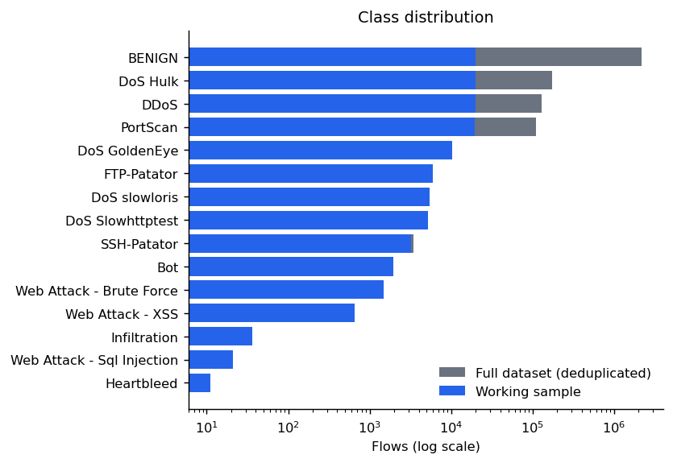
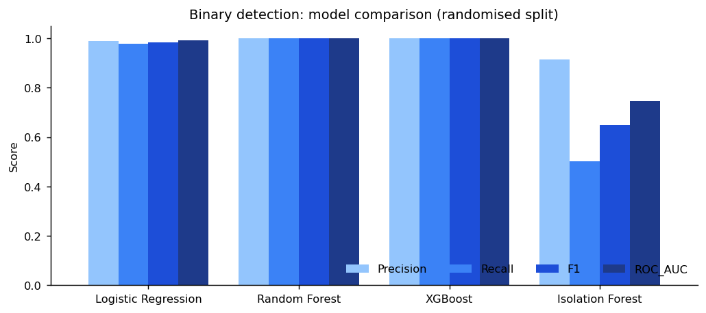
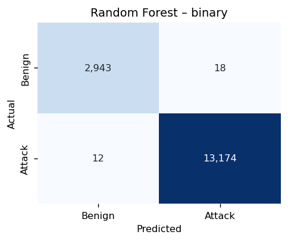
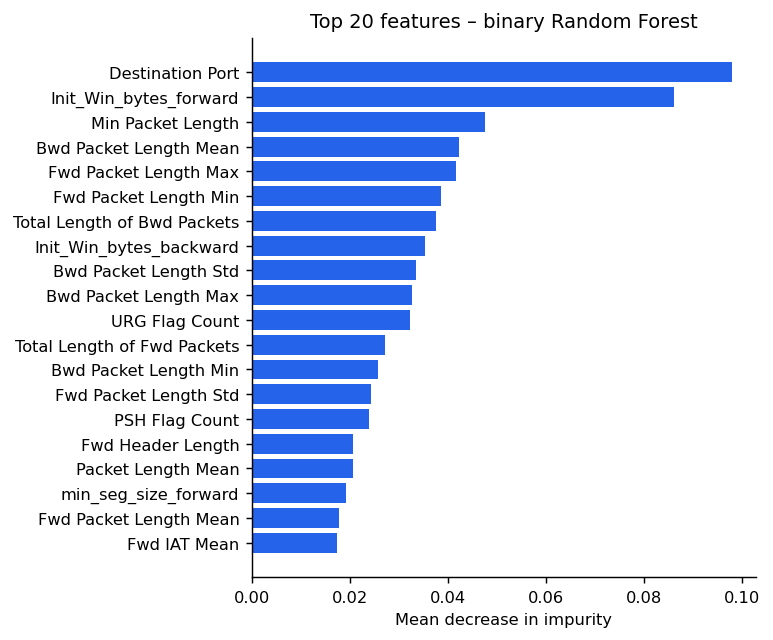
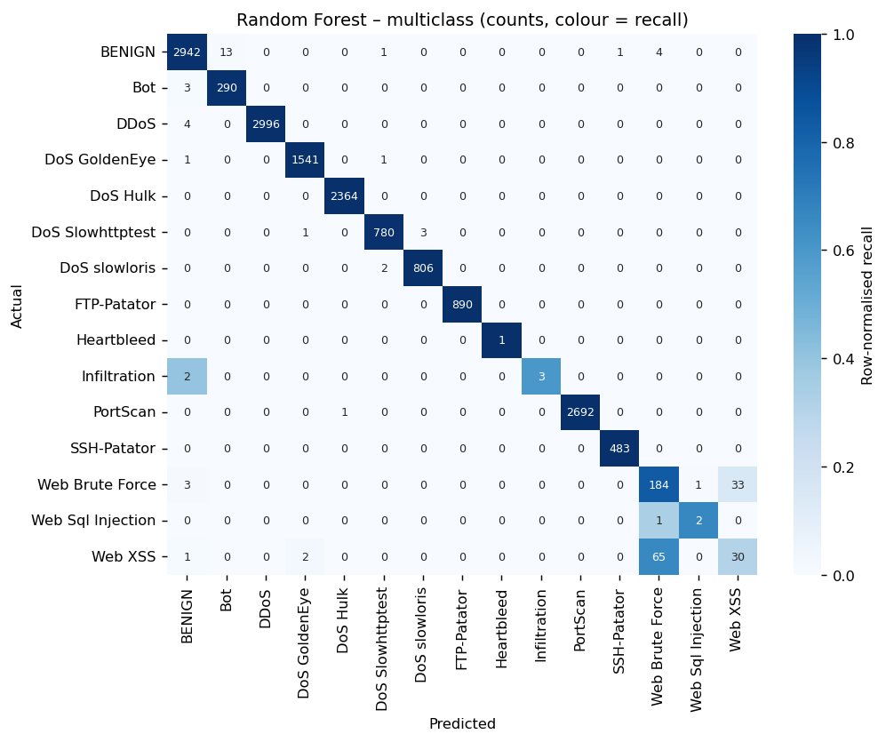
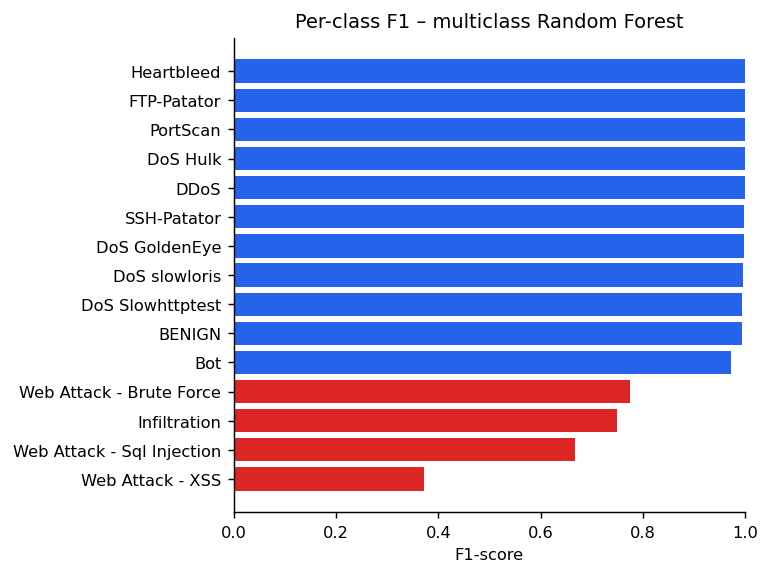
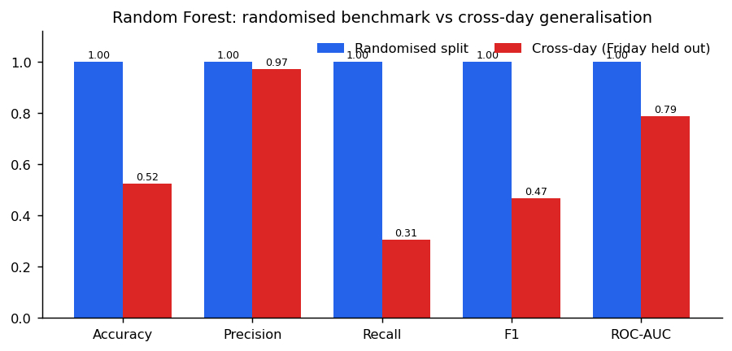

# AI-Based Network Intrusion Detection System Using Machine Learning

## Abstract
This project develops a machine-learning-based network Intrusion Detection System (IDS) using the
CIC-IDS2017 dataset. The system processes labelled network-flow records, cleans and transforms the
data, removes constant and highly redundant features, and trains several machine-learning models to
detect malicious traffic. Binary classification separates benign traffic from attacks, and
multiclass classification identifies the specific attack category. Random Forest, XGBoost, Logistic
Regression and Isolation Forest are evaluated using accuracy, precision, recall, F1-score, ROC-AUC
and confusion matrices. On a randomised split the tree-based models reach an F1-score above 0.999.
In a stricter cross-day experiment, where Friday traffic is held out, attack recall falls to about
31 %. This shows that benchmark scores greatly overstate how well the models detect attack families
they have not seen. A Streamlit dashboard lets users upload network-flow CSV files and view
predictions, attack types, alerts and evaluation metrics.

## 1. Introduction
Signature-based IDSs such as Snort detect known attacks reliably but cannot recognise new
variants without new rules. Machine-learning IDSs learn statistical patterns of traffic from labelled
flows and can, in principle, generalise beyond exact signatures. The objectives of this project are:

1. build a reproducible preprocessing and training pipeline for CIC-IDS2017;
2. compare supervised (Logistic Regression, Random Forest, XGBoost) and unsupervised (Isolation
   Forest) approaches for attack detection;
3. classify attacks into their specific categories;
4. assess realistic generalisation with a time-based (cross-day) evaluation;
5. provide a usable detection dashboard.

## 2. Dataset
CIC-IDS2017 was produced by the Canadian Institute for Cybersecurity. Benign background traffic
from 25 simulated users and a series of attacks were captured over five working days (3–7 July 2017).
The traffic was then converted into bidirectional flows with CICFlowMeter. The *MachineLearningCSV*
archive contains eight CSV files with 78 flow features (durations, packet counts and lengths,
inter-arrival times, TCP flags, window sizes, active/idle times) and a `Label` column.

| Day | File(s) | Attacks |
|---|---|---|
| Monday | Monday-WorkingHours | none (benign only) |
| Tuesday | Tuesday-WorkingHours | FTP-Patator, SSH-Patator |
| Wednesday | Wednesday-workingHours | DoS Hulk, GoldenEye, slowloris, Slowhttptest, Heartbleed |
| Thursday | Morning-WebAttacks, Afternoon-Infilteration | Web Brute Force, XSS, SQL Injection, Infiltration |
| Friday | Morning, Afternoon-PortScan, Afternoon-DDos | Bot, PortScan, DDoS |

The dataset contains about 2.83 million flows (about 2.62 million after removing exact duplicates).
It is heavily imbalanced: about 83 % of flows are benign, while Infiltration (36), SQL Injection
(21) and Heartbleed (11) have very few examples (Figure 1).


*Figure 1 – Flows per class in the full deduplicated dataset and in the working sample (log scale).*

## 3. Preprocessing
All preprocessing is implemented in `src/pipeline.py` and streams the files in chunks of 200,000
rows, so it runs with roughly 1 GB of free memory.

1. **Column names** – surrounding whitespace stripped (e.g. `" Destination Port"`).
2. **Duplicate column** – `Fwd Header Length` occurs twice in the raw files. The second copy is
   later removed as a perfectly correlated feature.
3. **Label normalisation** – the web-attack labels contain a broken en-dash
   (`Web Attack � Brute Force`), which is repaired to `Web Attack - Brute Force`.
4. **Numeric conversion** – all features cast to numbers, and `±∞` (produced by `Flow Bytes/s` and
   `Flow Packets/s` when duration is 0) replaced with missing values.
5. **Duplicates** – exact duplicate rows removed.
6. **Imputation** – missing values replaced with the **median learned from the training split only**,
   so no information leaks from the test data.
7. **Constant features** – 10 features with a single value were removed (`Bwd PSH Flags`,
   `Fwd/Bwd URG Flags`, `CWE Flag Count` and the six `*Bulk*` features).
8. **Redundant features** – for each pair with absolute Pearson correlation > 0.995 on the training
   data, one feature was removed. Examples: `Subflow Fwd Packets` ≡ `Total Fwd Packets`, and
   `Avg Fwd Segment Size` ≡ `Fwd Packet Length Mean`. 11 features were removed.

This leaves **57 features** for the final models.

## 4. Working Dataset and Experimental Setup
Because of the dataset's size and imbalance, a stratified working sample with **at most 20,000 flows
per class** was drawn. Each row receives a random key, and the rows with the smallest keys are kept
per class, which gives a uniform sample without loading the full dataset into memory. Rare classes
keep all their flows. The resulting sample contains 107,641 flows across 15 labels.

The working sample was split 85 % / 15 % with stratification (random seed 42). For the binary task,
every non-`BENIGN` label is mapped to *attack* (1).

| Model | Configuration |
|---|---|
| Logistic Regression | standardised inputs, `class_weight="balanced"`, max 2000 iterations |
| Random Forest (binary) | 200 trees, `class_weight="balanced_subsample"` |
| Random Forest (multiclass) | 250 trees, `class_weight="balanced_subsample"` |
| XGBoost | 300 trees, depth 8, learning rate 0.1, subsample 0.9 |
| Isolation Forest | 200 trees, trained **only on benign** training flows |

**Metrics.** Accuracy, precision (share of alerts that are real attacks), recall (share of attacks
detected), F1-score and ROC-AUC. For an IDS, recall measures missed attacks and precision measures
false alarms, so both matter more than accuracy on imbalanced data.

## 5. Binary Detection Results

| Model | Accuracy | Precision | Recall | F1 | ROC-AUC |
|---|---:|---:|---:|---:|---:|
| Logistic Regression | 0.9725 | 0.9886 | 0.9776 | 0.9831 | 0.9910 |
| Random Forest | 0.9986 | 0.9989 | 0.9993 | 0.9991 | 0.9998 |
| **XGBoost** | **0.9989** | **0.9990** | **0.9997** | **0.9993** | **1.0000** |
| Isolation Forest | 0.5560 | 0.9155 | 0.5028 | 0.6491 | 0.7446 |


*Figure 2 – Binary model comparison on the randomised split.*

The tree ensembles clearly outperform the linear baseline. The relationships between flow
statistics and attacks are non-linear (e.g. specific port and window-size combinations). XGBoost
and Random Forest are practically tied. Random Forest was chosen for the dashboard because it needs
no extra dependency at inference time, trains in parallel, and gives directly interpretable feature
importances.

On 16,147 test flows, the binary Random Forest produced 18 false alarms and missed 12 attacks
(Figure 3).


*Figure 3 – Confusion matrix of the binary Random Forest.*

**Isolation Forest.** The unsupervised model detects only about half of the attacks. Many attacks in
CIC-IDS2017 (e.g. slow DoS, brute force, web attacks) look like ordinary HTTP/FTP/SSH sessions at
the flow level, so they are not statistical outliers. Anomaly detection could still catch new
attacks, but on its own it is too weak for this dataset.

**Feature importance.** The most informative features are `Destination Port`,
`Init_Win_bytes_forward`, `Min Packet Length` and packet-length statistics (Figure 4). Destination
port matters because each attack targets one service (21 FTP, 22 SSH, 80 HTTP). This is a useful
signal, but it also ties the model to this lab network.


*Figure 4 – Top 20 features of the binary Random Forest (mean decrease in impurity).*

## 6. Multiclass Results
The multiclass Random Forest reached **99.11 % accuracy** and a **macro F1 of 0.90** on 16,147 test flows.


*Figure 5 – Multiclass confusion matrix (numbers = counts, colour = recall per class).*


*Figure 6 – Per-class F1-score. Red bars are below 0.8.*

- DoS/DDoS, PortScan, FTP/SSH-Patator and Bot reach F1 ≥ 0.97.
- **Web Attack – XSS** (F1 0.37) and **Brute Force** (F1 0.78) are mostly confused *with each other*:
  65 of 98 XSS flows were predicted as Brute Force. Both are HTTP requests from the same attacker
  against the same web application, so their flows look almost identical. Separating them would need
  payload information, which flow features do not contain.
- **Infiltration** (5 test flows), **SQL Injection** (3) and **Heartbleed** (1) have too few examples
  for reliable per-class estimates.

The macro F1 (0.90) is much lower than the accuracy (0.99) because macro F1 weights every class
equally. This makes the weakness on rare classes visible.

## 7. Cross-Day Generalisation
Randomised splits put flows from the same attack session in both training and test sets. Many
flows are near-duplicates, so the model is partly tested on traffic it has effectively already seen.
A stricter test was therefore run: **train on Monday–Thursday, test on all Friday traffic**. Friday
contains Bot, PortScan and DDoS, which do not occur on the training days.

| Evaluation | Accuracy | Precision | Recall | F1 | ROC-AUC |
|---|---:|---:|---:|---:|---:|
| Randomised split | 0.9986 | 0.9989 | 0.9993 | 0.9991 | 0.9998 |
| **Cross-day (Friday held out)** | **0.523** | **0.972** | **0.306** | **0.466** | **0.786** |


*Figure 7 – Random Forest performance on the randomised benchmark vs the cross-day test.*

Precision stays high: when the model raises an alert it is usually right. But recall drops to about
31 %. The reproduction run (Section 10) shows how this splits by attack type:

| Friday class | Flows | Flagged as attack |
|---|---:|---:|
| BENIGN | 395,093 | 0.3 % (false alarms) |
| DDoS | 128,016 | 63.6 % |
| PortScan | 90,819 | 0.6 % |
| Bot | 1,953 | 0.0 % |

DDoS is partly detected because it resembles the Wednesday DoS attacks. PortScan and Bot behave
differently from every attack in the training data and are almost completely missed. **The model
detects variants of known attacks well but does not detect new attack families.** This is the main
finding of the project and the main limitation of supervised flow-based IDSs.

## 8. Dashboard
`dashboard/app.py` is a Streamlit application with three tabs:

- **Detection** – upload a CICFlowMeter-format CSV (or use the bundled 3,218-flow sample). Choose
  binary mode (normal vs attack, adjustable alert threshold) or multiclass mode (attack type plus
  confidence; low-confidence attacks are marked *REVIEW*). The tab shows summary metrics, class
  distribution, the attack-probability histogram, the most targeted ports, a filterable results
  table, and a CSV download. If the file contains a `Label` column, it also shows accuracy,
  precision, recall, F1 and a confusion matrix against the true labels.
- **Model performance** – the comparison table, cross-day metrics and all report figures.
- **About** – method summary, limitations and the list of required input features.

Input handling follows the training pipeline exactly: column-name stripping, numeric conversion,
∞ → NaN, and the saved median imputer. If required columns are missing, the dashboard shows a clear
error that lists them.

Run it with `streamlit run dashboard/app.py`.

## 9. Limitations
- CIC-IDS2017 is a lab dataset from a single network. Real traffic is more diverse, and port-based
  signals do not transfer to other networks.
- Some attack classes have very few examples (11–36 flows).
- Randomised row splits overestimate generalisation (Section 7).
- Flow features contain no payload, which limits the separation of web attacks.
- The dashboard analyses files and does not capture live packets.
- Real deployment would require continuous flow collection, drift monitoring, threshold tuning for
  an acceptable false-alarm rate, and validation on independent datasets (e.g. CSE-CIC-IDS2018,
  UNSW-NB15).

## 10. Reproducibility
The full pipeline can be re-run from the raw CSV files:

```bash
python src/pipeline.py --data "path/to/MachineLearningCVE" --out <output folder>
```

An independent re-run from scratch (stored in `results/reproduction/`) confirms all conclusions.
The exact numbers differ slightly because the sample composition differs; the borderline
correlation decisions kept 53 features instead of 57.

| Re-run | Result |
|---|---|
| Binary RF / XGBoost F1 (randomised) | 0.9993 / 0.9995 |
| Multiclass RF accuracy / macro F1 | 0.9910 / 0.863 (XSS F1 0.34, SQL injection F1 0.00) |
| Logistic Regression / Isolation Forest F1 | 0.972 / 0.548 |
| Cross-day RF accuracy / precision / recall / F1 / ROC-AUC | 0.773 / 0.987 / 0.371 / 0.540 / 0.848 |

The cross-day accuracy is higher in the re-run (0.77 vs 0.52) because its Friday test set contains a
larger share of benign flows. Recall, the decisive metric, is low in both runs (31–37 %).

## 11. Conclusion
A complete machine-learning IDS was built for CIC-IDS2017: chunked preprocessing, feature reduction
from 78 to 57 features, binary and multiclass models, a model comparison, and an interactive
dashboard. Tree ensembles (Random Forest, XGBoost) detect attacks almost perfectly when similar
attacks appear in training (F1 > 0.999), and they identify 10 of 14 attack types with F1 ≥ 0.97.
The cross-day experiment shows the limit of this approach: attack families absent from training are
largely missed (recall ≈ 31 %). Reported benchmark accuracies for flow-based IDSs should therefore be
read with caution, and time- or attack-based splits should be part of every evaluation.

## 12. Future Work
- Live flow ingestion (CICFlowMeter / Zeek → model) with streaming alerts.
- Combining supervised detection with anomaly detection (e.g. autoencoders) for unknown attacks.
- Leave-one-attack-family-out evaluation and validation on CSE-CIC-IDS2018 / UNSW-NB15.
- Oversampling or cost-sensitive learning for rare classes, and threshold tuning against a target
  false-alarm rate.
- Per-alert explanations (SHAP) for security analysts.
- SIEM integration (e.g. alerts to Elastic/Splunk).

## References
1. I. Sharafaldin, A. H. Lashkari, A. A. Ghorbani, "Toward Generating a New Intrusion Detection
   Dataset and Intrusion Traffic Characterization," *Proc. ICISSP*, 2018.
2. Canadian Institute for Cybersecurity, "Intrusion Detection Evaluation Dataset (CIC-IDS2017),"
   University of New Brunswick. https://www.unb.ca/cic/datasets/ids-2017.html
3. L. Breiman, "Random Forests," *Machine Learning*, 45(1), 5–32, 2001.
4. T. Chen, C. Guestrin, "XGBoost: A Scalable Tree Boosting System," *Proc. KDD*, 2016.
5. F. T. Liu, K. M. Ting, Z.-H. Zhou, "Isolation Forest," *Proc. ICDM*, 2008.
6. F. Pedregosa et al., "Scikit-learn: Machine Learning in Python," *JMLR*, 12, 2825–2830, 2011.
7. G. Engelen, V. Rimmer, W. Joosen, "Troubleshooting an Intrusion Detection Dataset: the CICIDS2017
   Case Study," *IEEE Security and Privacy Workshops*, 2021.
